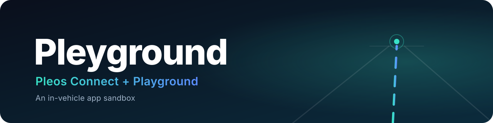
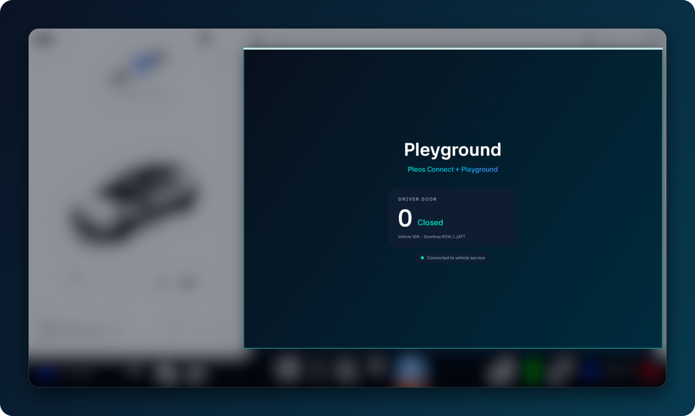

<p align="center">
  
</p>

<p align="center">
  
  
  
  
  
</p>

**Pleyground = Pleos Connect + Playground** — a sandbox for prototyping in-vehicle apps on Pleos Connect.

<p align="center">
  
  <br>
  <sub>Hello app on the Pleos Connect emulator. Surrounding Pleos UI intentionally blurred · © 42dot / Hyundai Motor Group.</sub>
</p>

## Quickstart

```bash
scripts/emu.sh start && scripts/emu.sh wait
./gradlew installDebug
adb shell am start -n dev.pleyground.hello/.MainActivity
```

Virtual Console: `scripts/emu.sh console` → http://127.0.0.1:8282

## Layout

| Path | What |
| --- | --- |
| `app/` | Hello app — reads the driver door position via the Vehicle SDK |
| `scripts/emu.sh` | Run the emulator from the terminal (`start` · `wait` · `stop` · `status` · `console`) |
| `docs/` | README assets |

## Requirements

- Android SDK with the Pleos Connect v2.1.0 system image ([setup guide](https://document.pleos.ai/docs/connect/guide/getting-started/application-development/setup-connect-sdk-emulator))
- JDK 17+

## License

[MIT](LICENSE) for the code in this repo. The Pleos SDK and emulator image are used under the 42dot SDK License Agreement and are not redistributed here.

<sub>Not affiliated with or endorsed by 42dot or Hyundai Motor Group. Pleos is a trademark of its owner.</sub>
